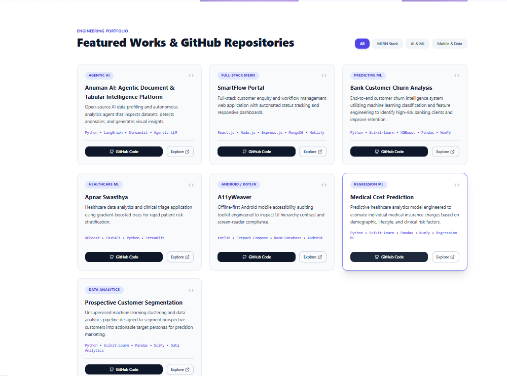
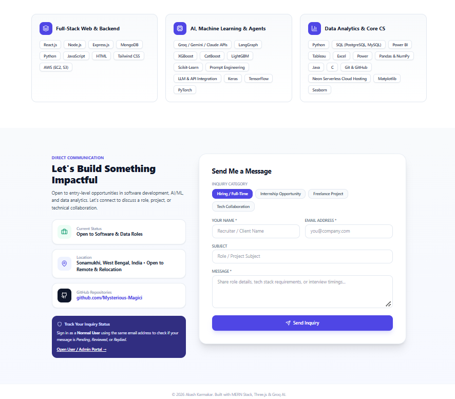
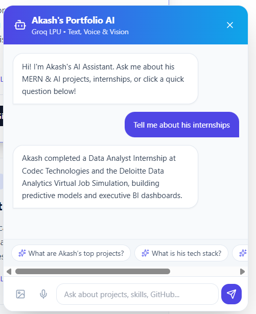
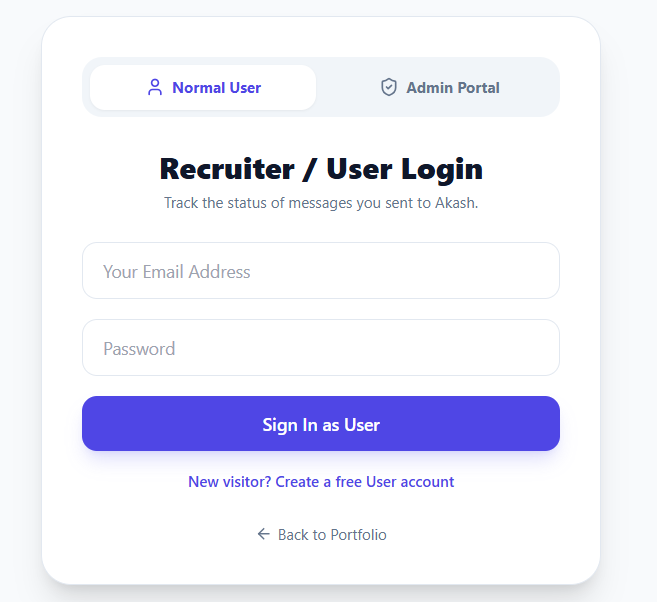
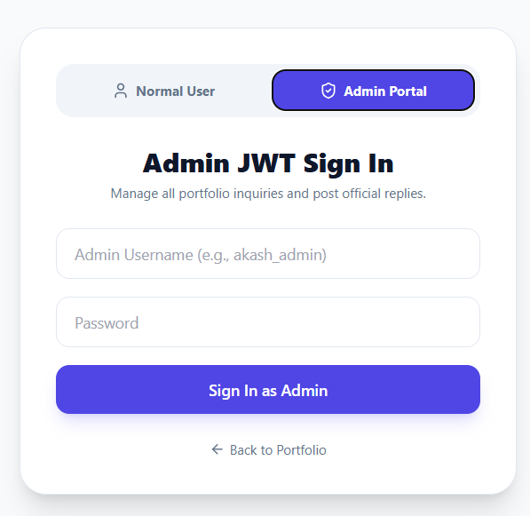

# Akash.dev — Interactive Full-Stack MERN & AI Portfolio

[](https://my-portfolio-mern-1i83.vercel.app/)
[]()
[]()

An interactive, production-grade engineering portfolio designed to bridge modern full-stack web architecture with autonomous generative AI workflows and end-to-end data systems.

---

##  Project Overview

This application serves as both a central technical showcase and a live demonstration of full-stack systems engineering. Beyond standard UI presentation, it features:
- **Groq LPU-Powered AI Assistant:** A multimodal interactive chatbot supporting text, voice, and vision queries to answer questions about architecture, internships, and skill competencies.
- **Two-Way Communication Pipeline:** An inquiry dispatcher with secure user/recruiter authentication and an administrative JWT dashboard to inspect and manage inbound messages.
- **Responsive 3D/Interactive Interface:** Engineered with React, Tailwind CSS, and Three.js for clean, low-latency client presentation.

---

##  Application Previews

| Section | Preview |
| :--- | :--- |
| **Hero & Navigation** |  |
| **Featured Works & Repositories** |  |
| **Skills & Communication Form** |  |
| **Multimodal Groq AI Assistant** |  |
| **Recruiter / Client Inquiry Portal** |  |
| **Admin JWT Management Dashboard** |  |

---

##  Tech Stack & Architecture

### Frontend
- **Framework & Libraries:** React.js, Tailwind CSS, Three.js
- **State Management:** React Hooks, Context API
- **Deployment:** Vercel

### Backend & Database
- **Runtime & Framework:** Node.js, Express.js
- **Authentication:** JSON Web Tokens (JWT), bcrypt encryption
- **Database:** MongoDB Atlas (Cloud)
- **Deployment:** Render / Cloud Hosting

### AI & Agent Integration
- **Inference Engine:** Groq LPU (Ultra-low latency text & multimodal inference)
- **Context Framework:** Agentic system prompting, dynamic contextual response generation

---

##  Core Features

1. **AI Portfolio Assistant (`Akash's Portfolio AI`)**
   - Natural language interaction regarding work experience, technical stack, and system designs.
   - Quick-prompt action pills for instant evaluation of technical depth and repositories.

2. **Full-Featured Project Showcase**
   - Dynamic categorizations across `MERN Stack`, `AI & ML`, and `Mobile & Data`.
   - Direct linkages to live deployments and underlying source repositories.

3. **Inquiry Lifecycle Tracking**
   - **Recruiter Interface:** Submit inquiry forms tagged by category (`Hiring/Full-Time`, `Internship`, `Collaboration`).
   - **Status Check:** Recruiters can sign in using their submission email to track message statuses (`Pending`, `Reviewed`, `Replied`).
   - **Admin Console:** Protected administrative access for reading incoming transmissions and pushing official replies.

---

##  Local Development Setup

### Prerequisites
- Node.js (v18.x or later)
- MongoDB instance (local or MongoDB Atlas connection string)
- Groq API Key

### 1. Clone Repository
```bash
git clone [https://github.com/Mysterious-Magici/my-portfolio-mern.git](https://github.com/Mysterious-Magici/my-portfolio-mern.git)
cd my-portfolio-mern
